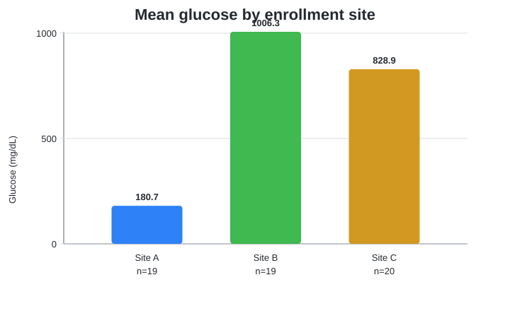

# Lab 5 workflow summary

## Inputs and analytic grain

The combined table contains **60 synthetic sample rows**. Glucose is missing for **2** samples.

The Lab 3 samples and Lab 4 TCGA patients have no shared identifier. The workflow therefore merges a one-row summary of the 566-patient cohort onto each synthetic sample. It does not assert patient-level linkage.

## Sample glucose summary

| Enrollment site | Non-missing n | Mean (mg/dL) | Median (mg/dL) |
|---|---:|---:|---:|
| Site A | 19 | 180.7 | 192.7 |
| Site B | 19 | 1006.3 | 240.8 |
| Site C | 20 | 828.9 | 176.8 |

## Lab 4 cohort context

- Patients: 566
- Median age at diagnosis: 66.0 years
- Mean nonsynonymous TMB: 10.02

Proportion of patients with at least one protein-altering mutation:

| Gene | Proportion |
|---|---:|
| TP53 | 0.507 |
| KRAS | 0.297 |
| EGFR | 0.122 |
| STK11 | 0.131 |
| KEAP1 | 0.180 |

## Interpretation caution

The synthetic glucose records and TCGA LUAD cohort describe different, unlinked populations. Cohort values are contextual summaries only and must not be used to infer associations with individual sample glucose values.
